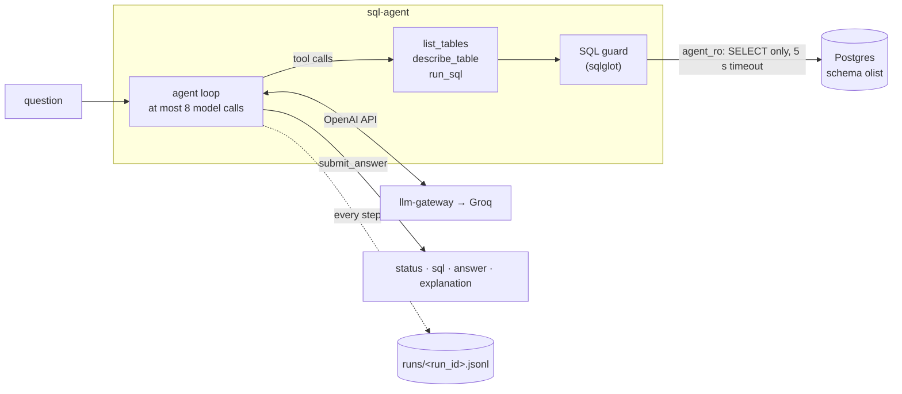

# sql-agent

**Proves:** "agent development" · "connecting LLMs to … internal databases"

A tool-calling agent that answers questions about the Olist Brazilian e-commerce dataset by writing and running SQL. It runs as a read-only database role behind a SQL guard, and it calls every model through [llm-gateway](https://github.com/Zubariya-Suleka/llm-gateway), which handles rate limits, retries, caching and per-request metrics.

## Demo
_TBD_

## How it works



- **The final answer is a tool.** The model finishes by calling `submit_answer`, whose arguments are the answer schema: `status` (`answered` / `cannot_answer` / `needs_clarification`), `sql`, `answer`, `explanation`. Groq can't combine tool calling with strict JSON output in one request, so a tool is the only way to keep both. The arguments are validated with pydantic, and `answered` also needs SQL that passes the guard. Anything invalid goes back to the model to fix.
- **Three layers of safety.** First, the guard parses the model's SQL and allows only one SELECT over the 9 olist tables. It rejects writes (even inside a CTE), `SELECT INTO`, `FOR UPDATE`, `SET`, side-effect functions (`pg_*`, `set_config`, ...) and other schemas, and it adds or caps `LIMIT 100`. Second, the query runs as `agent_ro`, which can only `SELECT` from schema `olist`, in read-only sessions with no temp tables. Third, a 5 s statement timeout stops runaway joins. The guard runs its own rendering of the parsed query, so the statement it checked is exactly the one that executes. Tests require that rendering to return the same rows as the original.
- **Schema knowledge lives in the database.** Table and column comments spell out this dataset's traps (see [Data notes](#data-notes)), and `list_tables` and `describe_table` read them from Postgres, so there's one source of truth.
- **The tools are built to save tokens.** Every tool result is re-sent to the model on every later step, so results are compact CSV with long cells cut. The system prompt has nothing per-request in it, so Groq's prompt cache can reuse it.
- **Every step is traced.** `runs/<run_id>.jsonl` records each model call (tool calls, reasoning, usage, gateway cache status), each tool result and the final answer. The same run id is sent to the gateway as `X-Trace-Id`, so its metrics rows join to the trace. This is the raw material for the failure analysis in [agent-trace-review](https://github.com/Zubariya-Suleka).
- **Malformed tool calls don't end the run.** When the model writes something Groq can't parse as a tool call, the trace keeps what it wrote (`failed_generation`), the agent tells it, and it tries again within the step limit.

## Results

First measurement: 10 questions covering all four question types ([scripts/smoke_questions.txt](scripts/smoke_questions.txt)), run on gpt-oss-20b on the Groq free tier, before the tool-call repair described below.

| | |
|---|---|
| Result types | 8 answered, 1 `needs_clarification` ("Who is the best seller?"), 1 `cannot_answer` ("profit margin": there's no cost data) |
| Steps per question | 5.2 on average (2 to 8) |
| Tokens per question, as counted by the rate limits | 4,807 on average, at most 9,916 |
| Prompt tokens served from Groq's prompt cache | 23% |
| Time for all 10 | 7 min, paced by the 8K tokens/min limit |

A full 100-question run therefore costs about 480K tokens, or 2.4 days of one model's free daily budget. That's why eval runs will be resumable (the gateway cache replays finished questions for free) and spread across models. These answers aren't scored yet; that's the job of the golden set in `sql-agent-evals`.

What failed at first, and how it was fixed:

- **The model wrote its plan instead of the final tool call.** On the very first live question, gpt-oss-20b got the right number (5,676) but then wrote "We have the answer: 5676 … Need to produce final answer" as plain text instead of calling `submit_answer`. Groq rejected it with `400 Parsing failed`, and the gateway, correctly, didn't retry a 4xx. The gateway now passes Groq's `failed_generation` through, and the agent treats it as a mistake to correct, not the end of the run.
- **A formatting tag stuck to the tool name.** In 5 of the 10 measured questions, the final `submit_answer` call failed to parse. In 4 of them the model had written a complete, correct call but named it `submit_answer<|channel|>commentary`: a tag from gpt-oss's internal message format leaking into the name. Each failure cost an extra model call, and one pushed a question to the 8-step limit. The agent now repairs exactly that shape: it strips the tag, checks the name is a real tool, then validates the call as usual and records the repair in the trace. Plain-text failures ("We have the answer.") still get the nudge.
- **A read-only check that proved less than it claimed.** The first `check_db.py` switched read-only mode off and then tried an INSERT in the *same* transaction. That transaction was still read-only, so the check never exercised privileges. It now commits between the two, and the INSERT fails on missing privileges (`InsufficientPrivilege`), which is the layer that actually matters.
- **Parser internals in front of the model.** On a typo, the guard initially told the model `Required keyword: 'expression' missing for <class 'sqlglot.expressions.core.Mul'>`. It now says where parsing failed (`near 'FROM' (line 1, column 7)`).

## Run it

Needs Python 3.11+, [uv](https://docs.astral.sh/uv/), [just](https://just.systems), Docker, and [llm-gateway](https://github.com/Zubariya-Suleka/llm-gateway) with a Groq key.

```
git clone https://github.com/Zubariya-Suleka/sql-agent
cd sql-agent
cp .env.example .env
just setup
```

1. Download the dataset from [Kaggle](https://www.kaggle.com/datasets/olistbr/brazilian-ecommerce) and unzip the 9 CSVs into `data/raw/`.
2. Start Postgres and load the data:
   ```
   just db up        # Windows: Docker Engine in a WSL distro (scripts/db.ps1); elsewhere: docker compose up -d
   just load         # 1.55M rows, about 45 s
   just check-db     # row counts as agent_ro, and proof it can only read
   ```
3. Start the gateway from its own folder: `uv run gateway serve --port 8100`.
4. Ask:
   ```
   uv run sql-agent ask "Which 5 states have the most unique customers?"
   uv run sql-agent ask "..." --model groq/qwen/qwen3.8-27b --json
   uv run python scripts/run_questions.py scripts/smoke_questions.txt
   ```

`just test` runs the unit tests everywhere. The database tests skip when Postgres isn't running, so CI stays green without it.

## Data notes

Facts the gold SQL (and the agent) must get right. Each was checked against the loaded data:

| Fact | Number |
|---|---|
| Orders, purchased 2016-09-04 to 2018-10-17 | 99,441 |
| `customer_id` is per order; the person is `customer_unique_id` | 96,096 people |
| Delivered orders that arrived after the estimated date | 7,827 of 96,476 (8.1%) |
| Orders with no items / no review / no payment | 775 / 768 / 1 |
| `review_id`s attached to more than one order | 789 |
| Products with no category | 610 |
| Categories with no English translation | 2 (`pc_gamer`, `portateis_cozinha_e_preparadores_de_alimentos`) |

Column names keep the source's typos (`product_name_lenght`), and amounts are in BRL. A question like "orders in 2018" needs to say which timestamp it means: purchase, approval, delivery or estimated delivery.

## What I'd do next

- Test whether sending gpt-oss's reasoning back between steps changes accuracy. Today the reasoning is kept in the trace but not re-sent, because Groq's docs don't say whether it's accepted as input.
- Measure the plan's Week 3 experiment: drop the "always call describe_table first" rule and see which questions flip.
